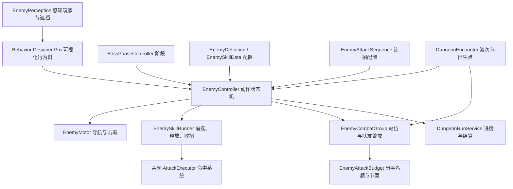

# 敌人控制、技能与两阶段 Boss

2026-10-28 更新：森林与晶窟 Boss 已增加 25% 血量的第三阶段、终阶段连招、HUD 提示与脱战重置，六种敌人新增命中反馈，详见 [CombatFlow.md](CombatFlow.md)。下文“两阶段”为此前版本记录。

## 体验入口

从 `Assets/Scenes/StartScene.unity` 运行，新游戏或继续游戏后使用主城传送门，选择「迷影森林」。`Dungeon01` 的第一波为两名暮影剑卫和一名赤焰咒术师；全部击败后，间隔 2.5 秒在北侧平台生成暮影领主。总目标为 4 个，最后击败 Boss 才结算奖励。失败可重试或返回主城。

「水晶洞窟」现在对应独立的 `Dungeon02`，从同一传送门选择即可进入。沿石板入口、狭长石桥进入水晶内殿，依次清理 3 名入口守卫、2 名内殿守卫和专属 Boss，共 6 个目标；开放普通、困难、噩梦三个难度。第二关资产与资源清单见文末。

## 职责划分

- **行为树**：使用已安装的 Behavior Designer Pro 3.3.3，按「脱战归位 → Boss 转阶段 → 战斗中后退/尝试连招 → 选招 → 靠近 → 待机」优先级决策。近战、远程、Boss 各有独立可视化 Subtree 资产。原 `EnemyBrain` 自制遍历器已移除；停止 Pro 树就会停止新决策。
- **动作状态机**：独占追击、攻击、受击、死亡、后退、转阶段与恢复等动作。正在执行的技能不会被每次行为树决策反复启动。普通怪受击取消前摇；Boss 按韧性阈值和技能霸体决定是否中断。恢复期间不发出新决策，连招间隙由同一动作状态机检查下一段能否执行。
- **技能执行**：每次攻击保存独立伤害倍率和瞄准快照；按技能时长与释放比例同步动画、预警和伤害。冷却属于怪物实例，不写回共享 ScriptableObject。已发射弹体可在收招后继续飞行；死亡、禁用、脱战重置和场景切换使旧上下文失效。
- **导航**：NavMeshAgent 与 Rigidbody 的移动由一个 Motor 管理。远程敌人优先拉开距离，直后方不可达时搜索侧后方完整路径；无路可退仍可近距离发射。寻路失败/长期停滞会归位。
- **阵营与命中**：玩家和敌人共用 AttackExecutor；敌人只伤害玩家，不互相伤害。飞行物逐帧球形扫掠，避免高速穿过目标，并被场景实体阻挡。
- **关卡**：波次管理只负责生成与完成通知；DungeonRunService 累计击杀收益，胜利时一次性发放。保留没有 DungeonEncounter 的旧场景流程和没有 Definition 的旧敌人配置。

## 已制作的敌人

资源均在 `Assets/Combat/Enemies/` 下，可直接从 Inspector 修改。

| 配置/预制体 | 普通难度生命 | 行为与技能 |
|---|---:|---|
| Data/Melee.asset · Prefabs/MeleeGuard.prefab | 65 | 追击、裂甲斩、受击中断；基础伤害 10 |
| Data/Ranged.asset · Prefabs/RangedCaster.prefab | 50 | 8 米优选距离、4 米内后退、暗焰飞行物；基础伤害 12 |
| Data/Boss.asset · Prefabs/ShadowLord.prefab | 600 | 一阶段横扫 18、震地 22；半血后增加地面烙印 25，以及双斩 14/16 接震地 22 的三段连招 |

Boss 在生命 ≤50% 时转入第二阶段，过渡动画 1.8 秒；震地和烙印期间霸体，其他动作累计 80 点伤害可触发受击。烙印前摇锁定玩家当时位置，玩家可离开预警圈躲避。Boss 不会在第一阶段使用烙印。

第二阶段近身时优先尝试「狂怒三连击」，独立冷却 10 秒。三段时长 1.15 / 1.25 / 1.5 秒，段间间隔 0.3 秒；每段重新检查射程、视线和朝向。离开射程会取消剩余段落，间隙受到足够韧性伤害也会中断。连招结束或因距离取消后进入 1.8 秒恢复，Boss 血条旁显示「反击机会」；Boss 在恢复状态承受 1.25 倍伤害。普通技能也有独立恢复时间：近战斩击 0.45 秒、远程弹 0.55 秒、Boss 横扫/震地/烙印分别 0.75 / 1.1 / 1.25 秒。

敌人先逐步转向目标，进入允许朝向角后才起手；一段技能开始后锁定朝向，玩家可以绕出扇形。预警线沿地面采样，并在释放前逐渐变亮、加粗；范围读取实际 AttackProfile。追击停止和重新追击使用不同距离阈值，减少攻击距离边缘来回启停。

连招可在 `Skills/BossEnragedCombo.asset` 调整段数、顺序、段间间隔、冷却和结束恢复。每段引用独立 EnemySkillData/AttackProfile；Boss Definition 的 `AttackFacingAngle`、`ApproachHysteresis` 和 `RecoveryDamageMultiplier` 分别控制起手角度、追击距离余量和恢复期承伤。当前连招复用现有横斩与震地动画、命中特效，前两段使用同一横斩动作的不同播放时长。

`Tools/RPG/Apply Enemy Combat Polish` 是这次追加资源的迁移入口：保留既有资产 GUID，并在 Boss 树的普通选招前插入连招节点。它会重新设置基础恢复时间和 Boss 起手角度/承伤倍率；日常调参直接编辑资产，不需要再次运行此命令。

两个近战怪、一个远程怪及 Boss 的普通难度通关总奖励为 **130 金币、275 经验**。副本倍率继续缩放敌人生命/伤害/奖励，全局难度继续缩放玩家承伤。

## 已有资源复用

- 近战与 Boss 使用现有 Enemy 吸血鬼模型；Boss 放大并使用独立红色材质。
- 远程使用 Polygon Fantasy Hero 的角色与法杖。
- 动画使用现有 Longsword Animset 与 RPG Character Mecanim 的剑/法杖动作。
- 命中、电光、暗焰弹、震地、爆发和狂暴光环来自现有 Hovl Magic Effects Pack。另存适配 URP 的材质和效果预制体，未修改供应商原资源。
- DungeonUI 增加 Boss 名称、阶段和血条；攻击扇形与范围圈由技能配置生成。

`EnemyEncounterAuthoring` 是本次资源组装的编辑器工具，拒绝覆盖已存在的 Boss 配置。日常扩展应编辑/复制现有配置及预制体，不反复运行初始生成命令。

## Behavior Designer Pro 编辑入口与运行方式

双击以下资产，在插件的 Behavior Designer 窗口编辑：

| 行为树 | 绑定的预制体 | 特有分支 |
|---|---|---|
| `Assets/Combat/Enemies/BehaviorTrees/Melee.asset` | `MeleeGuard`、旧 `Resources/Enemy` | 归位、协作站位、申请名额选招、追击、待机 |
| `Assets/Combat/Enemies/BehaviorTrees/Ranged.asset` | `RangedCaster` | 优先撤退，其次寻找射击空隙，再申请名额攻击 |
| `Assets/Combat/Enemies/BehaviorTrees/Boss.asset` | `ShadowLord` | 归位之后尝试半血转阶段；战斗中优先尝试第二阶段连招，再选普通技能 |

三份资产当前分别包含 14、17、15 个逻辑节点，使用插件原生 Repeater、Sequence、Selector，以及 `RPG Silent/Enemies` 分类中的自定义 Action/Conditional。Pro 3.3 的 GameObject Task 由 StackedAction/StackedConditional 承载，每个叶节点内放一个任务；任务脚本在 `Assets/Scripts/Enemies/BehaviorDesigner/EnemyTasks.cs`。

根节点持续重复「等待决策 → 优先选择」。`WaitForEnemyDecision` 每 0.15 秒放行一次；攻击、硬直、恢复和阶段过渡期间等待动作完成。移动/攻击节点返回 Success 表示命令已接受，动作本身由 EnemyController/EnemySkillRunner 继续执行。因此树每轮从最高优先级重新判断，也不会反复重启技能。编辑树时保留这个等待节点，避免无限重复的立即完成节点在同一帧空转。

每个任务在 OnAwake 缓存所属 EnemyController；生命、仇恨、目标和阶段读取实际组件，技能参数继续来自 EnemyDefinition/EnemySkillData，没有在黑板复制另一套状态。以后新增巡逻点或分支参数时可以增加 SharedVariable。

BehaviorTree 组件关闭自动启动，由 EnemyController 初始化后的下一帧启动。禁用组件、禁用物体、死亡和副本结算均停止树并取消技能；重新启用存活敌人后重新启动。两个近战实例共享同一个资产，但运行时任务实例与技能冷却各自独立。运行中选择场景里的敌人，再在 Behavior Designer 窗口查看对应实例，可以观察节点状态。

`Tools/RPG/Install Enemy Behavior Designer Trees` 用于首次生成和重新接线；已存在的树不会被重新生成，保留手工调整。修改节点或复制树可直接使用插件编辑器。用户安装的 `Packages/com.opsive.behaviordesigner`、`com.opsive.graphdesigner`、`com.opsive.shared` 是嵌入包，本次未改动供应商源码。

## 新增敌人或关卡

### 同波敌人协作

`DungeonEncounter.GroupCombat` 配置当前关卡的小队节奏。每波创建独立 `EnemyCombatGroup`；出生时显式绑定普通怪，Boss 保留自身连招节奏。没有绑定小队的旧 Enemy 仍使用原逻辑。

| 参数 | 当前 Dungeon01 值 | 行为 |
|---|---:|---|
| MaxAttackers / MaxMeleeAttackers / MaxRangedAttackers | 2 / 1 / 1 | 同时持有出手名额的总数、近战数和远程数；名额包含攻击后的恢复时间 |
| AttackStartInterval | 0.8 秒 | 两个敌人的起手至少错开此时间 |
| AttacksPerBurst / BurstPause | 2 / 1.4 秒 | 每两次起手后，下次起手至少再隔 1.4 秒 |
| HandoffDelay | 0.25 秒 | 收招结束或被打断释放名额后保留短间隔 |
| RequestLifetime | 0.6 秒 | 不再满足攻击条件的旧申请自动失效，避免队首阻塞 |
| AllyAlertRadius | 26 米 | 适配当前三个出生点的距离；同波附近队友收到警戒，仍受各自脱战半径限制。新配置默认 12 米 |
| PositionRefreshInterval / PositionTolerance | 0.6 秒 / 0.65 米 | 站位重算节拍与到达容差 |

Pro 的 `CoordinateEnemyPosition` 位于近战选招之前，远程撤退之后。近战从玩家周围 12 个候选方向选择可达站位，同角色保留至少 60° 的方向间隔，优先分开并保留已选站位。远程起手前检查包含队友的射线通道，受阻时尝试侧移。站位使用完整 NavMesh 路径、视线与出生点距离检查；找不到合适位置时回退到原追击分支，攻击名额限制仍然生效。远程飞行物离手后继续由原命中系统管理，这里限制的是起手与动作数量，不保证所有弹体的落点时刻互不重叠。

只有射程、冷却、朝向和视线满足时才申请攻击名额。同一可用通道按申请先后轮换，正在等待近战名额的敌人不会阻塞远程通道。恢复结束、受击打断、脱战、禁用、死亡均释放名额；禁用解除注册，重新启用只注册一次。换波、结算、重试和离开场景清空整组状态，没有全局静态队列。

`Tools/RPG/Install Enemy Group Coordination` 为现有近战和远程树追加站位节点，重复运行不重复插入，不重建原树。参数保存在 Dungeon01 的 DungeonEncounter 上，不需要额外插件或手工接线。

### 新增配置步骤

1. 复制 EnemyDefinition 与 EnemySkillData，分别配置生命、移动、射程、技能时长、释放点、冷却、阶段限制和特效。命中类型和基础伤害在技能引用的 AttackProfile 中。
2. 为模型配置 Animator 状态；状态名称匹配技能 AnimationState。调整状态播放速度，使动作长度与技能 Duration 一致。技能时点不依赖导入动画中的事件。
3. 复制对应敌人预制体并替换 Definition/模型/Animator。需要不同决策时复制对应行为树并修改 BehaviorTree 的 Subgraph 引用；同一套决策只需共享树和替换技能配置。需要两阶段时添加 BossPhaseController 并配置阈值、过渡与光环，使用含 TryBossPhaseTransition 节点的树。
4. 在目标场景的 DungeonEncounter 配置 Waves 和出生点，使用适合该场景的 NavMeshAgent 类型；新场景需登记到现有 DungeonDatabase/Addressables 流程。

## 验证方式与边界

2026-10-26 在 Unity 6000.0.66f2 Editor 中完成 51 项运行检查：普通流程 38 项记录为 `Tools/Validation/EnemyEncounterResults.txt`，困难流程 13 项记录为 `Tools/Validation/EnemyEncounterHardResults.txt`。经 StartUI 新游戏、主城传送门进入 Dungeon01，验证实际近战命中/打断、远程弹体/绕障后退、阵营过滤、伤害快照、波次推进、Boss 转阶段/霸体/地面攻击躲避、奖励去重、胜利重试、失败返回主城。困难倍率下初始敌人生命为 98/75、Boss 900，通关 195 金币/414 经验；原配置未被污染。4 个出生点均有从入口到达的完整 NavMesh 路径。

最终运行 Console 为 0 error / 0 warning；新资源中的 11 个预制体、31 个材质和 5 个技能通过缺失脚本、材质支持、技能/动画引用检查。Boss 血条截图检查后已移到关卡目标下方，避免重叠，困难流程重新加载确认布局已保存。预览为 `Tools/Validation/Captures/enemy-boss-hud.png`。测试结束已退出 Play Mode、返回 StartScene 并恢复原存档路径设置。

`Tools/Validation/EnemyEncounterMcp.cs.txt` 在运行中的 Dungeon01 通过真实 AI、攻击上下文和结算按钮验证近战、远程、阶段、波次、通关、重试和返回。它会传送测试玩家、隔离敌人和自动治疗以便测量，不代表人工完整通关或战斗平衡验收。必须在进入 Play Mode 前，将 Editor SessionState `RPGSilent.Validation.SaveDirectory` 指向项目 Temp 下的独立目录；结束后退出 Play Mode 并恢复原键值。

`EnemyEncounterHardMcp.cs.txt` 从新会话的 Main 开始验证困难流程。历史 `DungeonFlowMcp.cs.txt` 中「5 个相同生命值敌人」是旧内容断言，本次关卡应使用上述新验证脚本。

首版没有增加巡逻、多目标仇恨、敌人队形或网络同步；后续小队协作见本文件新增章节。参数仍需人工试玩调整；独立 Windows 构建不属于这次 Editor 流程验证。

## 2026-10-26：Behavior Designer Pro 迁移验证

在同一 Unity 6000.0.66f2 Editor 中完成迁移，重新编译成功，最终运行 Console 为 0 error / 0 warning。插件窗口实际加载近战、远程、Boss 三份树，分别显示 13 / 16 / 14 个逻辑节点，GraphEditor.GetErrors 均为 0，结果见 `Tools/Validation/EnemyBehaviorDesignerGraphResults.txt`。三份树和四个敌人预制体均已保存。

共 72 项 MCP Play Mode 检查通过：

- 普通完整流程 38 项：`Tools/Validation/EnemyBehaviorDesignerNormalResults.txt`，复用 `EnemyEncounterMcp.cs.txt`。覆盖真实近战/远程攻击、打断、撤退、两阶段 Boss、预警躲避、胜利奖励、重试、失败和返回主城。
- 困难流程与插件生命周期 26 项：`EnemyBehaviorDesignerHardResults.txt`，脚本 `EnemyBehaviorDesignerMcp.cs.txt`。验证 900 HP Boss、195 金币/414 经验，独立运行任务实例、决策频率、组件/物体禁用重启、死亡停止，以及仅停止插件后不再发生新决策。
- 边界流程 8 项：`EnemyBehaviorDesignerEdgeResults.txt`，脚本 `EnemyBehaviorDesignerEdgesMcp.cs.txt`。验证攻击中脱战解除决策锁、完整归位，以及真实敌人命中导致玩家死亡时停止树、取消技能、失败零奖励和返回复活。

初次迁移回归发现旧测试假定「移动玩家后才开始下一招」，而 Pro 在动作完成当帧即可选招；已把躲避断言改为读取实际 LineRenderer 预警中心。日志记录了预警中心和当时玩家位置，并保持实际零伤害断言。另修复了 EnemySkillRunner.ReleaseAttack 的回调重入：命中触发副本失败会同步取消当前技能，现在返回后先检查技能/攻击上下文仍有效，再访问技能资源；上述真实致命命中流程已覆盖修复。

验证使用 `Temp/EnemyBDValidation` 独立存档；已退出 Play Mode、回到 StartScene，并恢复原存档路径与后台运行设置。保留迁移前记录和初次失败记录，以便追溯。没有执行独立 Windows 构建、IL2CPP 裁剪验证、压力测试或人工战斗平衡验收。

## 2026-10-27：战斗节奏与 Boss 连招

追加平滑转向起手、技能内锁定朝向、地面投影预警、独立恢复状态，以及第二阶段狂怒三连击。Boss 血条显示当前连招段数或「反击机会」；禁用后重新启用时恢复第二阶段光环。敌人和特效继续复用项目已有资源，未替换模型。

Unity 6000.0.66f2 中通过 96 项 MCP Play Mode 检查：

| 范围 | 项数 | 结果文件（`Tools/Validation/`） |
|---|---:|---|
| 新机制：转向、绕背避伤、恢复锁、三段独立命中、反击增伤、脱离范围、霸体/间隙硬直、光环恢复、通关 | 24 | `EnemyCombatPolishResults.txt` |
| 普通完整流程：近战/远程、波次、Boss、躲避、胜利、重试、失败返回 | 38 | `EnemyCombatPolishNormalResults.txt` |
| 困难倍率、导航和 Pro 实例/启停生命周期 | 26 | `EnemyCombatPolishHardResults.txt` |
| 攻击中脱战归位、致命命中同步结算与技能取消 | 8 | `EnemyCombatPolishEdgeResults.txt` |

新机制脚本为 `EnemyCombatPolishMcp.cs.txt`；其余复用上述既有脚本。普通流程现在通过实际 `AoeAtPoint` 命中类型识别烙印，以免把新增第二阶段连招误当成烙印。绕背验证从导航可达且无遮挡的侧后方采样，保持处于近战半径内再验证零伤害；不会把墙体遮挡或距离过远算作成功躲避。

`EnemyCombatPolishAssetsMcp.cs.txt` 实际打开三份 Pro 树，13 / 16 / 15 节点均无 GraphEditor 错误；四个敌人预制体无缺失脚本，技能、命中配置、动画及预警材质引用有效。旧 Resources/Enemy 继续使用运行时生成的兼容技能。结果见 `EnemyCombatPolishAssetResults.txt`。反击窗口画面已检查，见 `Captures/enemy-combat-recovery.png`。

验证使用 `Temp/EnemyPolishValidation` 独立存档；敌人验证结束后已退出 Play Mode，恢复原存档路径和后台运行设置，StartScene 未被修改。最终重新导入并完成编译。运行期间工作区出现了另外的玩家移动代码更新，未覆盖或改写这些修改；96 项记录对应执行当时已加载的程序集，不能作为那些并行修改的专项验收。之后另一项玩家控制验证以 `Temp/PlayerControlValidation-20261027` 启动了新的 Play Mode 会话，保留该会话，没有再次停止 Editor 或恢复其存档键值。后续快照及 Console 查询见 `EnemyCombatPolishEditorState.txt`、`EnemyCombatPolishConsoleResults.json`。

这轮连招工作没有执行独立 Windows 构建或人工战斗平衡验收；当时的后续项为群体协作、第二张关卡与成长内容，群体协作的进展见下一节。现有横斩动画复用的视觉差异有限，三段节奏和伤害参数仍需实际试玩微调。

## 2026-10-27：多敌人协作与围攻验证

Dungeon01 第一波两名近战和一名远程已接入每波独立的 `EnemyCombatGroup`。沿用原出生点、模型、攻击动画和特效，新增同波警戒传递、近战分散站位、远程受阻侧移，以及贯穿攻击和恢复动作的出手名额。Boss 保持自身两阶段与连招节奏。参数位于场景 `DungeonEncounter.GroupCombat`，当前最多同时一名近战、一名远程处于攻击或恢复动作，起手间隔至少 0.8 秒，每两次起手后至少间隔 1.4 秒。

Unity 6000.0.66f2 中完成 103 项 MCP Play Mode 检查，另有 10 项 NUnit EditMode 检查通过：

| 范围 | 项数 | 结果文件（`Tools/Validation/`） |
|---|---:|---|
| 原出生点警戒与接敌、持续围攻、分开站位、起手间隔、打断/禁用/脱战清理、Boss 连招、通关重试和失败返回 | 27 | `EnemyGroupResults.txt` |
| 队友阻挡射线、单独射手侧移后恢复攻击、不可达位置拒绝、移动目标刷新站位 | 12 | `EnemyGroupEdgeResults.txt` |
| 普通完整流程：真实命中、近战/远程、波次、两阶段 Boss、预警躲避、奖励与返回 | 38 | `EnemyGroupNormalResults.txt` |
| 困难倍率、四个出生点完整导航路径、Pro 独立任务实例与启停生命周期 | 26 | `EnemyGroupHardResults.txt` |
| 名额限制、同通道先后顺序、远程通道、间隔、失效请求、重复释放、清空与组间隔离 | 10 | `EnemyGroupEditModeResults.json` |

专项脚本为 `EnemyGroupMcp.cs.txt` 与 `EnemyGroupEdgesMcp.cs.txt`。围攻测量持续 30 秒，实际记录到两名近战轮换出手、远程重复支援和玩家受到真实伤害。先在原出生点验证接敌，再在当前关卡可达地面放置测试角色测量节奏；自动治疗和传送仅存在于验证脚本，不属于运行时 AI。画面见 `Captures/enemy-group-coordination.png`。

测试过程发现布点采样可能落入与出生点不连通的 NavMesh 区域，造成近战归位路径不完整；验证脚本现同时检查出生点到布点的完整路径、布点到玩家的完整路径以及两名近战的间距，修正后 27 项全部通过。诊断保留在 `EnemyGroupTerrainDiagnosis.txt`。射线边界测试也等待角色初始化并同步物理变换后才开始断言；初次布点记录保留在 `EnemyGroupEdgesFixtureAttempt.txt`。一次 EditMode 测试被另一个会话切入 Play Mode 打断，记录为 `EnemyGroupEditModeInterrupted.json`；独占编辑器后重跑 10 项全部通过。

三份 Pro 树分别为 14 / 17 / 15 个逻辑节点，GraphEditor 错误为 0；四个敌人预制体无缺失脚本，技能/动画引用有效，见 `EnemyGroupAssetResults.txt`。验证使用 `Temp/EnemyGroupValidation-20261027` 独立存档，保留同工作区的玩家控制修改。最终重新导入与编译完成，Console 为 0 error / 0 warning；已退出 Play Mode，回到未修改的 StartScene，清除测试存档覆盖键，恢复后台运行设置和正常时间倍率。Console 与恢复状态分别记录于 `EnemyGroupConsoleResults.json` 和 `EnemyGroupEditorState.txt`。

本轮范围为 Editor 内真实运行验证，未执行独立 Windows 构建、大量敌人压力测试或人工战斗平衡验收。远程弹体离手后的飞行时间和玩家操作会影响实际命中时刻；起手节奏约束不等同于所有命中之间都有固定空档。

## 2026-10-27：第二关「水晶洞窟」

场景为 `Assets/Scenes/Dungeon02.unity`，独立导航资产为 `Assets/Scenes/Dungeon02/NavMesh-Dungeon02.asset`。副本 1002 通过现有 Addressables Scene 组的 `Scenes/Dungeon02` 加载；副本 1001 继续使用 `Scenes/Dungeon01`。入口为 `(0, 0.05, -23)`，朝向正 Z。场景启用玩家战斗，使用同一套跨场景玩家、难度、结算和进度保存服务。

三波配置是「2 枪卫 + 1 祭司」「1 枪卫 + 1 祭司」「晶核守望者」。普通怪沿用同波协作，近战/远程各一个名额，起手间隔 0.9 秒，每两次起手后至少间隔 1.6 秒，警戒传递半径 18 米。Boss 保持独立节奏。以下文件均位于 `Assets/Combat/CrystalCavern/`，没有覆盖第一关技能或供应商原资源。

| 敌人 / 数据及预制体名称 | 普通生命 | 攻击方式 | 复用模型 |
|---|---:|---|---|
| 晶刺枪卫 / `CrystalLancer` | 90 | 贯晶突刺：16 伤害、3.4 米、55° 窄角；锁定起手方向，可绕背或打断 | Polygon Fantasy Hero `Chr_FantasyHero_Preset_2`，Kingdom `SM_Wep_Spear_01` |
| 晶咒祭司 / `CrystalSeer` | 70 | 晶蚀领域：锁定玩家地面位置，半径 2.3 米，持续 4 秒，每秒 6 伤害；保持 9 米距离，近身撤退 | Polygon Fantasy Hero `Chr_FantasyHero_Preset_12`，Kingdom `SM_Wep_Staff_09` |
| 晶核守望者 · 瑟莱恩 / `CrystalWarden` | 900 | 晶锤重劈 24、晶环震荡 28、晶刺爆发 26；半血后增加碎晶领域和共鸣崩裂连招 | Polygon Fantasy Hero `Chr_FantasyHero_Preset_3`，放大 1.65 倍，Kingdom `SM_Wep_Hammer_06` 和背部水晶 |

守望者第二阶段的「共鸣崩裂」为晶环震荡接碎晶领域，段间 0.4 秒、冷却 12 秒，结束后有 2.2 秒反击窗口。碎晶领域半径 3 米、持续 5 秒、每秒 9 伤害；恢复时承受 1.3 倍玩家伤害。技能范围、地面预警和持续区域半径对应配置；玩家应在预警后离开锁定位置。持续区域在施法收招后仍存在，死亡、禁用、脱战或结算导致攻击上下文失效后停止伤害并回收。

| 难度 | 枪卫 / 祭司 / Boss 生命 | 通关金币 | 通关经验 |
|---|---|---:|---:|
| 普通 | 90 / 70 / 900 | 258 | 590 |
| 困难 | 135 / 105 / 1350 | 387 | 884 |
| 噩梦 | 180 / 140 / 1800 | 516 | 1180 |

经验按每只敌人的倍率结果分别取整，因此困难下祭司的 55 × 1.5 取 82，再求和得到 884。全局难度仍会进一步缩放玩家承伤。

资源来源：Polygon Fantasy Kingdom 的石板、石桥、岩壁和武器；Polygon Nature Biomes Enchanted Forest 的水晶；RPG Character Mecanim 的长枪、双手斧与施法动作；Hovl Magic Effects 的 `Crystals crossfade`、`AoE slash blue`、`Crystal effect blue` 和 `Plexus`。专属材质、效果、动画控制器、六份技能、持续领域预制体和三份 Pro 树均另存到 `CrystalCavern`。三份树继续使用已验证的近战、远程和 Boss 决策结构，技能差异由各自的配置驱动。

`Tools/RPG/Create Crystal Cavern` 仅用于首次创建；存在场景或资产目录时会拒绝覆盖。日常编辑使用场景、预制体和 ScriptableObject。当前配置已接线，无需再执行创建菜单。

画面检查修正了 Synty 厘米制骨骼导致挂件过小的问题：武器与背部水晶现在补偿父骨骼缩放；长枪、法杖、重锤的实际长度约为 2.26 / 1.44 / 2.05 米。洞窟采用现有石板制作连续地基与外侧封板，避免岩壁接缝露出背景或地面缺口；内侧仍保留岩壁、水晶和石桥。波次标题已缩短，Boss 阶段和反击提示不会挤占目标行。最终画面见 `Tools/Validation/Captures/dungeon02-entry-final.png` 和 `dungeon02-boss-final.png`，其余同名前缀图片属于修正前或测试布点记录。

在 Unity 6000.0.66f2 中，最终保存后的场景通过以下验证，结果文件均位于 `Tools/Validation/`：

| 范围 | 项数 | 结果文件 |
|---|---:|---|
| 资源与场景：实际 Pro 图无错误（14 / 17 / 15 节点）、动画、技能、材质、可见武器尺寸、持续区域、Addressables、六个出生点导航 | 52 | `Dungeon02AssetResults.txt` |
| 实际 Input System W 输入与玩家刚体，从入口经石桥走到内殿，约 57 米，无掉落、阻滞或异常高度 | 7 | `Dungeon02TraversalResults.txt` |
| 普通：真实突刺命中、绕背与打断、持续领域多次伤害及躲避/回收、协作警戒、Boss 二阶段和连招、破绽增伤、通关、重试、失败返回 | 46 | `Dungeon02NormalResults.txt` |
| 困难：生命/伤害倍率、阶段阈值、387 金币 / 884 经验、实际自动存档读取、同难度重试、失败清理与返回 | 21 | `Dungeon02HardResults.txt` |
| 噩梦：同上，516 金币 / 1180 经验，奖励不重复且不会改写共享敌人配置 | 21 | `Dungeon02NightmareResults.txt` |
| 第一关普通回归：原近战/弹体、两阶段 Boss、奖励、重试与失败返回 | 38 | `Dungeon02ForestRegressionResults.txt` |

脚本分别为 `Dungeon02AssetsMcp.cs.txt`、`Dungeon02TraversalMcp.cs.txt`、`Dungeon02Mcp.cs.txt` 和 `Dungeon02DifficultyMcp.cs.txt`。普通测试从实际传送界面选择第二关后启动；难度测试从 Main 启动并操作实际传送按钮。普通脚本默认连续运行，若需 Boss 截图，运行前设置 AppDomain `D02.capture=true`，在 `Running 22/28` 后截图并在 180 秒内设置 `D02.continue=true`。`Dungeon02CaptureTimeoutResults.txt` 保留了此前人工截图等待超时的记录，最终流程已完整重跑通过。

初轮运行与同工作区的武器接入同时进行，出现玩家预制体暂缺武器组件的异常，见 `Dungeon02InitialConsole.json`；待玩家预制体接线完成后，使用最新配置重跑了上述最终验证。测试通过 `Temp/Dungeon02Validation-20261027` 独立存档进行，不修改正式存档。战斗测量会隔离敌人、传送/自动治疗玩家并通过攻击上下文完成指定伤害；行走测试则使用真实输入和刚体移动。这些记录证明 Editor 内功能与流程，不等同于人工战斗平衡验收或独立 Windows 构建通过。

合计 133 项 MCP Play Mode 检查、52 项资源检查通过。第一关回归复用 `EnemyEncounterMcp.cs.txt`，以 `EC.continue=true` 自动继续其截图检查点。最终 Console 为 0 error / 0 warning，见 `Dungeon02ConsoleResults.json`。已退出 Play Mode、回到未修改的 StartScene、清除测试存档覆盖并恢复后台运行和时间倍率，见 `Dungeon02EditorState.txt`。
