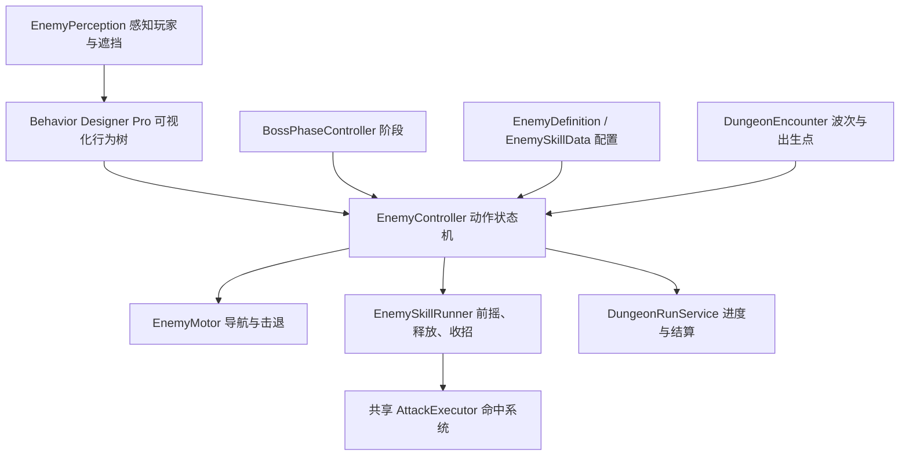

# 敌人控制、技能与两阶段 Boss

## 体验入口

从 `Assets/Scenes/StartScene.unity` 运行，新游戏或继续游戏后使用主城传送门，选择「迷影森林」。`Dungeon01` 的第一波为两名暮影剑卫和一名赤焰咒术师；全部击败后，间隔 2.5 秒在北侧平台生成暮影领主。总目标为 4 个，最后击败 Boss 才结算奖励。失败可重试或返回主城。

当前「水晶洞窟」数据库记录也指向同一个 Dungeon01，所以会使用同一套遭遇；本次没有制作第二张地图。

## 职责划分

- **行为树**：使用已安装的 Behavior Designer Pro 3.3.3，按「脱战归位 → Boss 转阶段 → 战斗中后退 → 选招 → 靠近 → 待机」优先级决策。近战、远程、Boss 各有独立可视化 Subtree 资产。原 `EnemyBrain` 自制遍历器已移除；停止 Pro 树就会停止新决策。
- **动作状态机**：独占追击、攻击、受击、死亡、后退、转阶段等动作。正在执行的技能不会被每次行为树决策反复启动。普通怪受击取消前摇；Boss 按韧性阈值和技能霸体决定是否中断。
- **技能执行**：每次攻击保存独立伤害倍率和瞄准快照；按技能时长与释放比例同步动画、预警和伤害。冷却属于怪物实例，不写回共享 ScriptableObject。已发射弹体可在收招后继续飞行；死亡、禁用、脱战重置和场景切换使旧上下文失效。
- **导航**：NavMeshAgent 与 Rigidbody 的移动由一个 Motor 管理。远程敌人优先拉开距离，直后方不可达时搜索侧后方完整路径；无路可退仍可近距离发射。寻路失败/长期停滞会归位。
- **阵营与命中**：玩家和敌人共用 AttackExecutor；敌人只伤害玩家，不互相伤害。飞行物逐帧球形扫掠，避免高速穿过目标，并被场景实体阻挡。
- **关卡**：波次管理只负责生成与完成通知；DungeonRunService 累计击杀收益，胜利时一次性发放。保留没有 DungeonEncounter 的旧场景流程和没有 Definition 的旧敌人配置。

## 已制作的敌人

资源均在 `Assets/Combat/Enemies/` 下，可直接从 Inspector 修改。

| 配置/预制体 | 普通难度生命 | 行为与技能 |
|---|---:|---|
| Data/Melee.asset · Prefabs/MeleeGuard.prefab | 65 | 追击、裂甲斩、受击中断；基础伤害 10 |
| Data/Ranged.asset · Prefabs/RangedCaster.prefab | 50 | 8 米优选距离、4 米内后退、暗焰飞行物；基础伤害 12 |
| Data/Boss.asset · Prefabs/ShadowLord.prefab | 600 | 一阶段横扫 18、震地 22；半血转阶段后增加锁定地面烙印 25 |

Boss 在生命 ≤50% 时转入第二阶段，过渡动画 1.8 秒；震地和烙印期间霸体，其他动作累计 80 点伤害可触发受击。烙印前摇锁定玩家当时位置，玩家可离开预警圈躲避。Boss 不会在第一阶段使用烙印。

两个近战怪、一个远程怪及 Boss 的普通难度通关总奖励为 **130 金币、275 经验**。副本倍率继续缩放敌人生命/伤害/奖励，全局难度继续缩放玩家承伤。

## 已有资源复用

- 近战与 Boss 使用现有 Enemy 吸血鬼模型；Boss 放大并使用独立红色材质。
- 远程使用 Polygon Fantasy Hero 的角色与法杖。
- 动画使用现有 Longsword Animset 与 RPG Character Mecanim 的剑/法杖动作。
- 命中、电光、暗焰弹、震地、爆发和狂暴光环来自现有 Hovl Magic Effects Pack。另存适配 URP 的材质和效果预制体，未修改供应商原资源。
- DungeonUI 增加 Boss 名称、阶段和血条；攻击扇形与范围圈由技能配置生成。

`EnemyEncounterAuthoring` 是本次资源组装的编辑器工具，拒绝覆盖已存在的 Boss 配置。日常扩展应编辑/复制现有配置及预制体，不反复运行初始生成命令。

## Behavior Designer Pro 编辑入口与运行方式

双击以下资产，在插件的 Behavior Designer 窗口编辑：

| 行为树 | 绑定的预制体 | 特有分支 |
|---|---|---|
| `Assets/Combat/Enemies/BehaviorTrees/Melee.asset` | `MeleeGuard`、旧 `Resources/Enemy` | 归位、近战选招、追击、待机 |
| `Assets/Combat/Enemies/BehaviorTrees/Ranged.asset` | `RangedCaster` | 战斗分支优先判断距离并撤退；无路径时继续尝试攻击 |
| `Assets/Combat/Enemies/BehaviorTrees/Boss.asset` | `ShadowLord` | 归位之后、战斗之前尝试半血转阶段 |

三份资产分别包含 13、16、14 个逻辑节点，使用插件原生 Repeater、Sequence、Selector，以及 `RPG Silent/Enemies` 分类中的自定义 Action/Conditional。Pro 3.3 的 GameObject Task 由 StackedAction/StackedConditional 承载，每个叶节点内放一个任务；任务脚本在 `Assets/Scripts/Enemies/BehaviorDesigner/EnemyTasks.cs`。

根节点持续重复「等待决策 → 优先选择」。`WaitForEnemyDecision` 每 0.15 秒放行一次；攻击、硬直和阶段过渡期间等待动作完成。移动/攻击节点返回 Success 表示命令已接受，动作本身由 EnemyController/EnemySkillRunner 继续执行。因此树每轮从最高优先级重新判断，也不会反复重启技能。编辑树时保留这个等待节点，避免无限重复的立即完成节点在同一帧空转。

每个任务在 OnAwake 缓存所属 EnemyController；生命、仇恨、目标和阶段读取实际组件，技能参数继续来自 EnemyDefinition/EnemySkillData，没有在黑板复制另一套状态。以后新增巡逻点或分支参数时可以增加 SharedVariable。

BehaviorTree 组件关闭自动启动，由 EnemyController 初始化后的下一帧启动。禁用组件、禁用物体、死亡和副本结算均停止树并取消技能；重新启用存活敌人后重新启动。两个近战实例共享同一个资产，但运行时任务实例与技能冷却各自独立。运行中选择场景里的敌人，再在 Behavior Designer 窗口查看对应实例，可以观察节点状态。

`Tools/RPG/Install Enemy Behavior Designer Trees` 用于首次生成和重新接线；已存在的树不会被重新生成，保留手工调整。修改节点或复制树可直接使用插件编辑器。用户安装的 `Packages/com.opsive.behaviordesigner`、`com.opsive.graphdesigner`、`com.opsive.shared` 是嵌入包，本次未改动供应商源码。

## 新增敌人或关卡

1. 复制 EnemyDefinition 与 EnemySkillData，分别配置生命、移动、射程、技能时长、释放点、冷却、阶段限制和特效。命中类型和基础伤害在技能引用的 AttackProfile 中。
2. 为模型配置 Animator 状态；状态名称匹配技能 AnimationState。调整状态播放速度，使动作长度与技能 Duration 一致。技能时点不依赖导入动画中的事件。
3. 复制对应敌人预制体并替换 Definition/模型/Animator。需要不同决策时复制对应行为树并修改 BehaviorTree 的 Subgraph 引用；同一套决策只需共享树和替换技能配置。需要两阶段时添加 BossPhaseController 并配置阈值、过渡与光环，使用含 TryBossPhaseTransition 节点的树。
4. 在目标场景的 DungeonEncounter 配置 Waves 和出生点，使用适合该场景的 NavMeshAgent 类型；新场景需登记到现有 DungeonDatabase/Addressables 流程。

## 验证方式与边界

2026-10-26 在 Unity 6000.0.66f2 Editor 中完成 51 项运行检查：普通流程 38 项记录为 `Tools/Validation/EnemyEncounterResults.txt`，困难流程 13 项记录为 `Tools/Validation/EnemyEncounterHardResults.txt`。经 StartUI 新游戏、主城传送门进入 Dungeon01，验证实际近战命中/打断、远程弹体/绕障后退、阵营过滤、伤害快照、波次推进、Boss 转阶段/霸体/地面攻击躲避、奖励去重、胜利重试、失败返回主城。困难倍率下初始敌人生命为 98/75、Boss 900，通关 195 金币/414 经验；原配置未被污染。4 个出生点均有从入口到达的完整 NavMesh 路径。

最终运行 Console 为 0 error / 0 warning；新资源中的 11 个预制体、31 个材质和 5 个技能通过缺失脚本、材质支持、技能/动画引用检查。Boss 血条截图检查后已移到关卡目标下方，避免重叠，困难流程重新加载确认布局已保存。预览为 `Tools/Validation/Captures/enemy-boss-hud.png`。测试结束已退出 Play Mode、返回 StartScene 并恢复原存档路径设置。

`Tools/Validation/EnemyEncounterMcp.cs.txt` 在运行中的 Dungeon01 通过真实 AI、攻击上下文和结算按钮验证近战、远程、阶段、波次、通关、重试和返回。它会传送测试玩家、隔离敌人和自动治疗以便测量，不代表人工完整通关或战斗平衡验收。必须在进入 Play Mode 前，将 Editor SessionState `RPGSilent.Validation.SaveDirectory` 指向项目 Temp 下的独立目录；结束后退出 Play Mode 并恢复原键值。

`EnemyEncounterHardMcp.cs.txt` 从新会话的 Main 开始验证困难流程。历史 `DungeonFlowMcp.cs.txt` 中「5 个相同生命值敌人」是旧内容断言，本次关卡应使用上述新验证脚本。

没有增加巡逻、多目标仇恨、敌人队形或网络同步。首版参数仍需人工试玩调整；独立 Windows 构建不属于这次 Editor 流程验证。

## 2026-10-26：Behavior Designer Pro 迁移验证

在同一 Unity 6000.0.66f2 Editor 中完成迁移，重新编译成功，最终运行 Console 为 0 error / 0 warning。插件窗口实际加载近战、远程、Boss 三份树，分别显示 13 / 16 / 14 个逻辑节点，GraphEditor.GetErrors 均为 0，结果见 `Tools/Validation/EnemyBehaviorDesignerGraphResults.txt`。三份树和四个敌人预制体均已保存。

共 72 项 MCP Play Mode 检查通过：

- 普通完整流程 38 项：`Tools/Validation/EnemyBehaviorDesignerNormalResults.txt`，复用 `EnemyEncounterMcp.cs.txt`。覆盖真实近战/远程攻击、打断、撤退、两阶段 Boss、预警躲避、胜利奖励、重试、失败和返回主城。
- 困难流程与插件生命周期 26 项：`EnemyBehaviorDesignerHardResults.txt`，脚本 `EnemyBehaviorDesignerMcp.cs.txt`。验证 900 HP Boss、195 金币/414 经验，独立运行任务实例、决策频率、组件/物体禁用重启、死亡停止，以及仅停止插件后不再发生新决策。
- 边界流程 8 项：`EnemyBehaviorDesignerEdgeResults.txt`，脚本 `EnemyBehaviorDesignerEdgesMcp.cs.txt`。验证攻击中脱战解除决策锁、完整归位，以及真实敌人命中导致玩家死亡时停止树、取消技能、失败零奖励和返回复活。

初次迁移回归发现旧测试假定「移动玩家后才开始下一招」，而 Pro 在动作完成当帧即可选招；已把躲避断言改为读取实际 LineRenderer 预警中心。日志记录了预警中心和当时玩家位置，并保持实际零伤害断言。另修复了 EnemySkillRunner.ReleaseAttack 的回调重入：命中触发副本失败会同步取消当前技能，现在返回后先检查技能/攻击上下文仍有效，再访问技能资源；上述真实致命命中流程已覆盖修复。

验证使用 `Temp/EnemyBDValidation` 独立存档；已退出 Play Mode、回到 StartScene，并恢复原存档路径与后台运行设置。保留迁移前记录和初次失败记录，以便追溯。没有执行独立 Windows 构建、IL2CPP 裁剪验证、压力测试或人工战斗平衡验收。
