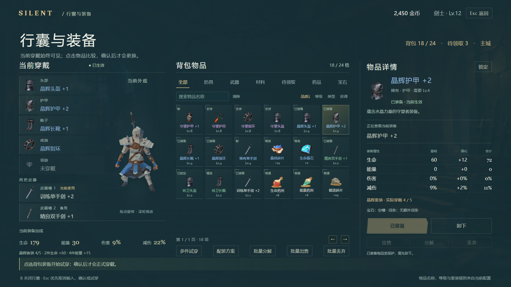

# 当前功能与 UI 设计对照 · Functional V5

核对时间：2026-10-29T11:37:41+08:00。当前工作区索引 **246 个第一方运行时 C# 文件、43 个 UI 脚本**，共 22,645 行；本稿包含 **84 个页面与关键状态 + 2 张参考页**，画布 1920 × 1080。

本轮从 UI 的入口、事件处理、业务服务、保存边界和 Resources 配置核对玩家操作。全量脚本已建立方法、UI 文案、服务调用与哈希索引；重点阅读 UI 及其业务实现。这不是对第三方包和全部底层算法的逐行技术审计，也没有把规划清单当作已实现功能。

- [打开设计画廊](index.html#inventory) · [关键页面总览](boards/hero-overview.png) · [全部页面总览](boards/all-pages-overview.png)
- [源文件索引](source-catalog.json) · [配置快照](configuration-catalog.json) · [逐功能与逐 UI 文件映射](functional-matrix.json)

## 先解决背包的可理解性

1. 左侧常驻“当前穿戴”：头部、护甲、靴子、戒指、项链，每行有部位、物品名、强化与空槽；其下列出两个武器槽及当前/备用。人物预览只辅助辨认。
2. 中间只做找物品：七类、搜索、四种双向排序、24 格物品、新/锁定/已装备标记；批量操作留在次级入口。
3. 右侧明确“将替换谁”：防具比较全身装备加成，计入强化、套装、实例词条和宝石；武器明确选槽 1 或 2。
4. 单件点选只试穿；当前清单和已生效属性不动，确认后更新。多件试穿累积部位，整套确认；Esc 先取消输入、确认、批量、试穿，再退出。
5. 示例用真实配置验算：晶辉护甲 +2 → 守望护甲 +1，全身生命 179 → 195、能量 30 → 15、伤害 9% → 9%、减伤 22% → 25%。护甲改善同时丢失晶辉四件能量 +15，不能只标“战力提升”。

## 当前功能、限制与操作路径

| 功能 | 当前实现必须保留的规则 | 设计操作 | 页面示例 |
|---|---|---|---|
| 启程与角色 | 新建只选择基础职业与性别；进阶分支在导师处开放。角色记录独立，删除与无法继续读取各自说明后果。 | 进入角色页 → 选择记录 → 继续；新建使用当前职业模型。 | [开始菜单](index.html#start)、[角色创建](index.html#creation)、[角色选择](index.html#characters)、[菜单 · 存档无法继续](index.html#save-menu-failed) |
| 游玩状态与战斗 | 生命、能量、冷却、职业机制、目标与 Boss 阶段分别固定位置；主城禁战，训练不发奖；危险预警与操作反馈不占任务列表。 | 战斗中保留视野，技能/药品用现有快捷键；需要鼠标时显示光标。 | [主城 HUD](index.html#hud-town)、[副本与 Boss HUD](index.html#hud-dungeon)、[世界标签与即时反馈](index.html#world-feedback)、[随机远征 · 事件与反馈](index.html#hud-expedition) |
| 拾取与离场 | L 附近列表、6 种品质显示筛选、每页 8 项；方向键选择，E/Enter 仅拾取可达物品。满包或保存失败仍留地面，金币经验吸附；离场有未拾取金红物品先确认。 | 选择掉落 → 拾取；品质筛选不改变掉落。 | [附近掉落 · 选择拾取](index.html#nearby-loot)、[离场前高品质掉落确认](index.html#loot-leave)、[世界标签与即时反馈](index.html#world-feedback) |
| 当前穿戴与试穿 | 5 个防具饰品槽与 2 个武器槽持续显示名称、强化、空槽和当前/备用。查看、试穿、实际穿戴分开；低等级可预览，确认需满足等级与角色状态。 | 防具：选中 → 对比全身变化 → 确认穿戴；武器：选中 → 指定槽 1/2。 | [背包与装备](index.html#inventory)、[背包 · 比较与试穿](index.html#inventory-tryon)、[背包 · 两个武器槽](index.html#inventory-weapon)、[背包 · 等级不足](index.html#inventory-low-level) |
| 背包整理与药品 | 24 格背包、待领取上限 256 项；7 类直接选择，名称搜索，品质/等级/类型/获得排序双向。新物品与锁定可见；药品设 Q/R/F，共享冷却。输入 B 不关闭，Esc 分层取消。 | 常用整理留在页面，批量选择后一次核对数量与结果。 | [背包 · 搜索与排序](index.html#inventory-search)、[药品与快捷栏配置](index.html#inventory-consumable)、[待领取物品](index.html#inventory-overflow)、[背包 · 批量出售](index.html#inventory-bulk-sell) |
| 整套方案、分解与丢弃 | 3 个方案保存 5 防具、2 武器与当前槽。多件试穿逐部位组合，确认整套前不变；涉及武器的整套调整回主城。出售/分解保护穿戴、两武器槽、锁定、宝石；分解仅防具饰品。丢弃可回收，离场消失。 | 复杂整理作为次要入口；单件穿戴不要求先建方案。 | [背包 · 多件试穿](index.html#inventory-outfit)、[配装方案](index.html#loadouts)、[批量分解](index.html#inventory-batch)、[丢弃数量确认](index.html#discard) |
| 装备特殊效果 | 仅传说/神话对应固有效果；I/II 两级，同类取最高，当前武器与已穿戴防具饰品才生效。试穿不触发，不靠换装刷新本场冷却。 | 物品详情就地打开规则，说明触发、效果、冷却和生效来源。 | [装备特殊效果说明](index.html#equipment-effects) |
| 任务、章节、收藏 | 当前 48 项任务、7 章主线、10 成就。NPC 接取/交付；手札追踪/取消追踪/放弃。章节门槛含等级、前置、故事、好感；职业考验需同一趟有效正式通关。放弃不撤回历史奖励或故事决定。 | 任务详情保留目标、进度、奖励、交付对象与追踪操作；成就达成后手动领取。 | [任务手札](index.html#journal)、[主线七章与接取条件](index.html#journal-chapters)、[放弃任务确认](index.html#journal-abandon)、[成就奖励](index.html#achievements) |
| NPC 服务、故事与成长 | 按 NPC 显示已实现服务。21 项技能：基础职业最高 3、进阶最高 5，学习后首个空槽自动装配。转职 Lv.10/300 金币且不可改分支。武器/防具强化最高 +5；宝石、13 配方、重铸均明确费用。5 段故事保留真实选择和好感。 | 技能直接选择十个位置；费用与结果同屏；故事先选择再确认。 | [导师技能服务](index.html#mentor)、[技能装配 · 十个位置](index.html#skill-assign)、[转职确认](index.html#advancement)、[武器强化](index.html#forge-weapon) |
| 互斥专精 | 4 个方向互斥、各 3 级；Lv.6/12/18，150/300/450 金币与 2/4/6 碎片。重置付 100，返已投金币 80%，材料不返。驭灵限御兽师已学召唤。 | 当前方向、下级变化、投入与重置返还同时可读。 | [职业专精 · 互斥方向](index.html#specialization)、[专精投入确认](index.html#specialization-confirm)、[专精重置与返还](index.html#specialization-reset) |
| 仓库存取 | 每角色 96 格，保留实例、强化、宝石和锁定。锁定可存取，穿戴及方案引用不可存，待领取须先入包。批量数量每页 8 项核对；满容量/保存失败整笔不变。 | 先选存入/取出方向，再选物品、核对清单和两侧容量。 | [仓库 · 存入](index.html#warehouse-deposit)、[仓库 · 取出](index.html#warehouse-withdraw)、[仓库 · 核对存取](index.html#warehouse-review) |
| 补给与误售回购 | 购买 1–99，总价与容量明确；满包新堆叠转待领取。晶核碎片由委托或好感 20 开放，好感 40/70 分别 10%/15% 优惠并向上取整。回购 48 小时/最近 24 项，整条原记录、原实例、原价；需直接放入背包。 | 商店两页直接选购买/回购；购买数量和回购原记录分别确认。 | [战斗补给商店](index.html#supplies)、[购买数量与总价](index.html#shop-purchase)、[误售物品回购](index.html#shop-buyback)、[回购原记录确认](index.html#shop-buyback-review) |
| 传送、远征与训练 | 2 张正式地图与独立训练场，地图各自难度。6 种模式：探索、限时、首领试炼、远征、首领连战、千层。远征种子决定阵型/精英/事件/可选节点，重试和读档沿用组合，场景进度重置；组合事件奖仅一次。 | 地点、难度与模式各自选择，六个模式一眼可点；出发前显示规则。 | [传送 · 迷影森林](index.html#portal-forest)、[传送 · 水晶洞窟](index.html#portal-crystal)、[传送 · 训练场](index.html#portal-training)、[传送 · 限时挑战](index.html#portal-timed) |
| 结算与长期挑战 | 常规结算与长期挑战分开。首领连战 6 轮、千层最高 1000，每 5 层首领，每轮 10 分钟；提交奖励纪录后恢复四分之一生命能量。待保存阻止继续/离场，失败重开第 1 轮。 | 成功先看奖励，再拾取/重试/回城；长期挑战休整时直接继续或结束。 | [通关结算](index.html#victory)、[死亡与失败结算](index.html#defeat)、[副本奖励 · 保存重试](index.html#reward-save-failed)、[长期挑战 · 轮间休整](index.html#long-rest) |
| 新手引导 | 14 步来自当前 TutorialTitles，保存角色进度，可跳过、回看、退出续接；按实际动作计数。 | 仅提示当前一步；完整步骤放入可翻页回看。 | [操作与职业教学](index.html#tutorial)、[新手引导 · 当前步骤](index.html#tutorial-current)、[新手引导 · 十四步回看](index.html#tutorial-review) |
| 设置、暂停与加载 | 4 页设置：屏幕、声音、14 项改键/控制、6 项游戏选项。新增伤害数字与反馈强度已对齐。应用保存、关闭撤销未应用修改、恢复默认仅预览；重复/保留键拒绝，冲刺/翻滚共享。加载失败可重试或按上下文返回；保存失败不继续离场。 | 同页操作后应用；Esc 先关展开项或取消改键，返回目的地明确。 | [设置 · 屏幕](index.html#settings-screen)、[设置 · 声音](index.html#settings-sound)、[设置 · 控制](index.html#settings-controls)、[设置 · 游戏](index.html#settings-game) |
| 共用布局与音效 | 共用按钮、字体、遮罩与可视反馈支撑上述页面；已实现按钮音效与音乐/音效设置联动，没有新增独立音效业务页。 | 同类状态与按钮保持一致。 | 全页共用 |

## 用当前配置校正的数值

- 64 项物品、6 套装备、48 项任务、10 项成就、5 段故事、13 张配方、21 项技能；名称、目标、奖励与条件见配置快照。角色职业共 9 个，创建仅开放基础职业，进阶走导师。
- 技能升级费用按目标等级计算，例如震荡斩 2 → 3 级为 120 金币，等级要求 7；不是固定 40。
- 强化最高 +5：下一等级 ×100 金币；防具饰品另需下一等级 ×2 碎片。基础属性强化按总等级向上取整，减伤加成上限 50%。
- 宝石合成 150 金币 +3 晶核碎片，镶嵌/替换/拆卸 50 金币；生命晶石 +30 生命、凝神晶石 +15 能量、锋芒晶石 +3% 伤害、守护晶石 +2% 减伤。
- 守望护甲为史诗，重铸费用 325 金币 +8 碎片；已穿戴也可选择，锁定/普通/堆叠物品受限，重铸保留强化与宝石。林卫护甲回购示例按原出售所得 40 金币。
- 普通难度枚举为 2，远征组合事件额外奖励为 80×2，即 160 金币/160 经验。森林示例种子 284941 按 ExpeditionPlan 得到守卫据点、近战前锋、护盾/治疗、补给箱与精英伏击。

## 阅读层级与呈现建议

采用低多边形奇幻的刻面、薄金线和少量徽记。菜单/传送用场景构图，装备/仓库用便于检索的网格和清单，故事用大段阅读区，战斗 HUD 留出中央视野。不同任务使用不同版式，不给所有页面套同一张大卡片。
常用按钮直达；只有涉及消耗、删除、互斥或不可逆决定时才单独核对。规则放在相关按钮旁，常态不展开长篇说明。保持品质文字与颜色并用、空槽文字明确、禁用原因就近可见。

## 资源与预览边界

三个新包沿用已完成的导入复核：[PONETI、Synty HUD、Synty Menus 记录](RESOURCE_AUDIT.md)。本稿取用的原始图片、GUID 与哈希见 [source-manifest.json](source-manifest.json)。设计图标是选型建议，游戏 Icon 引用没有改变。
本轮额外按实际装备定义渲染四组剑士预览：当前、护甲试穿、武器试穿、空防具。Unity 使用隔离 PreviewRenderUtility 场景与现有 ModularArmorAppearance，StartScene 前后均为干净且未运行；详见 [渲染记录](model-render-verification.json)。HTML 使用预渲染代表组合，不是完整的实时三维换装系统。
部分 HUD 与传送底图为已导入 Synty 示例图，只用于看排版层级，不代表实际关卡或 Boss。图鉴部分沿用职业模型占位，正式内容可用现有敌人/NPC 模型补渲。中文正文字体仍使用系统 Microsoft YaHei 预览，未复制分发；落地需要可分发的中文字体与 TMP 字体资产。

## 验证与工程边界

- `qa-report.json`：逐张导出，检查图片加载、画布越界、面板溢出和底部按钮遮挡。
- `interaction-qa.json`：通过浏览器鼠标/键盘检查背包当前穿戴、单件试穿/取消/确认、双武器目标、低等级、待领取、中文搜索、B/Esc 层级、整套确认、批量保护与数量、模式直达、引导翻页等。
- `asset-qa.json`：核对 122 个复制资源与 10 个派生预览的输出哈希。
- 复杂交易、任务进度、存档故障等页面使用场景样例展示规则；HTML 不调用真实游戏服务，不代表全套业务可在浏览器执行。
- 本轮仅写入新设计目录及压缩包。没有修改游戏 C#、Assets、场景、预制体、项目设置或存档，没有运行游戏验收测试。
- 共享工作区在本轮期间有其他开发修改，新增设置和改键保护已重新核对；[变动记录](source-drift.json) 不属于本设计任务所做修改。后续实际落地应再次核对当时服务接口。

## 43 个 UI 脚本覆盖

| UI 源文件 | 对应功能 | 页面数 |
|---|---|---|
| [Assets/Scripts/UI/CharacterCreationView.cs](../../../Assets/Scripts/UI/CharacterCreationView.cs) | 启程与角色 | 4 |
| [Assets/Scripts/UI/CharacterModelPreview.cs](../../../Assets/Scripts/UI/CharacterModelPreview.cs) | 启程与角色 | 4 |
| [Assets/Scripts/UI/CharacterSelectionView.cs](../../../Assets/Scripts/UI/CharacterSelectionView.cs) | 启程与角色 | 4 |
| [Assets/Scripts/UI/StartUI.cs](../../../Assets/Scripts/UI/StartUI.cs) | 启程与角色 | 4 |
| [Assets/Scripts/UI/MainUI.Adventure.cs](../../../Assets/Scripts/UI/MainUI.Adventure.cs) | 游玩状态与战斗 | 6 |
| [Assets/Scripts/UI/MainUI.Combat.cs](../../../Assets/Scripts/UI/MainUI.Combat.cs) | 游玩状态与战斗 | 6 |
| [Assets/Scripts/UI/MainUI.cs](../../../Assets/Scripts/UI/MainUI.cs) | 游玩状态与战斗 | 6 |
| [Assets/Scripts/UI/MainUI.EquipmentEffects.cs](../../../Assets/Scripts/UI/MainUI.EquipmentEffects.cs) | 游玩状态与战斗 | 6 |
| [Assets/Scripts/UI/MainUI.Journey.cs](../../../Assets/Scripts/UI/MainUI.Journey.cs) | 游玩状态与战斗 | 6 |
| [Assets/Scripts/UI/MainUI.Targeting.cs](../../../Assets/Scripts/UI/MainUI.Targeting.cs) | 游玩状态与战斗 | 6 |
| [Assets/Scripts/UI/SkillSlotUI.cs](../../../Assets/Scripts/UI/SkillSlotUI.cs) | 游玩状态与战斗 | 6 |
| [Assets/Scripts/UI/WeaponEquipmentUI.cs](../../../Assets/Scripts/UI/WeaponEquipmentUI.cs) | 游玩状态与战斗 | 6 |
| [Assets/Scripts/UI/MainUI.Loot.cs](../../../Assets/Scripts/UI/MainUI.Loot.cs) | 拾取与离场 | 3 |
| [Assets/Scripts/UI/InventoryUI.cs](../../../Assets/Scripts/UI/InventoryUI.cs) | 当前穿戴与试穿 | 6 |
| [Assets/Scripts/UI/InventoryUI.Consumables.cs](../../../Assets/Scripts/UI/InventoryUI.Consumables.cs) | 背包整理与药品 | 6 |
| [Assets/Scripts/UI/InventoryUI.Organization.cs](../../../Assets/Scripts/UI/InventoryUI.Organization.cs) | 背包整理与药品 | 6 |
| [Assets/Scripts/UI/InventoryUI.Discard.cs](../../../Assets/Scripts/UI/InventoryUI.Discard.cs) | 整套方案、分解与丢弃 | 4 |
| [Assets/Scripts/UI/InventoryUI.Management.cs](../../../Assets/Scripts/UI/InventoryUI.Management.cs) | 整套方案、分解与丢弃 | 4 |
| [Assets/Scripts/UI/InventoryUI.Effects.cs](../../../Assets/Scripts/UI/InventoryUI.Effects.cs) | 装备特殊效果 | 1 |
| [Assets/Scripts/UI/MainUI.Quests.cs](../../../Assets/Scripts/UI/MainUI.Quests.cs) | 任务、章节、收藏 | 5 |
| [Assets/Scripts/UI/QuestJournalUI.Chapters.cs](../../../Assets/Scripts/UI/QuestJournalUI.Chapters.cs) | 任务、章节、收藏 | 5 |
| [Assets/Scripts/UI/QuestJournalUI.Collections.cs](../../../Assets/Scripts/UI/QuestJournalUI.Collections.cs) | 任务、章节、收藏 | 5 |
| [Assets/Scripts/UI/QuestJournalUI.cs](../../../Assets/Scripts/UI/QuestJournalUI.cs) | 任务、章节、收藏 | 5 |
| [Assets/Scripts/UI/TownNpcUI.cs](../../../Assets/Scripts/UI/TownNpcUI.cs) | NPC 服务、故事与成长 | 13 |
| [Assets/Scripts/UI/TownNpcUI.Quests.cs](../../../Assets/Scripts/UI/TownNpcUI.Quests.cs) | NPC 服务、故事与成长 | 13 |
| [Assets/Scripts/UI/TownNpcUI.World.cs](../../../Assets/Scripts/UI/TownNpcUI.World.cs) | NPC 服务、故事与成长 | 13 |
| [Assets/Scripts/UI/TownNpcUI.Specialization.cs](../../../Assets/Scripts/UI/TownNpcUI.Specialization.cs) | 互斥专精 | 3 |
| [Assets/Scripts/UI/TownNpcUI.Warehouse.cs](../../../Assets/Scripts/UI/TownNpcUI.Warehouse.cs) | 仓库存取 | 3 |
| [Assets/Scripts/UI/TownNpcUI.Commerce.cs](../../../Assets/Scripts/UI/TownNpcUI.Commerce.cs) | 补给与误售回购 | 4 |
| [Assets/Scripts/UI/TownNpcUI.Supplies.cs](../../../Assets/Scripts/UI/TownNpcUI.Supplies.cs) | 补给与误售回购 | 4 |
| [Assets/Scripts/UI/PortalUI.cs](../../../Assets/Scripts/UI/PortalUI.cs) | 传送、远征与训练 | 9 |
| [Assets/Scripts/UI/DungeonUI.cs](../../../Assets/Scripts/UI/DungeonUI.cs) | 结算与长期挑战 | 7 |
| [Assets/Scripts/UI/DungeonUI.LongChallenges.cs](../../../Assets/Scripts/UI/DungeonUI.LongChallenges.cs) | 结算与长期挑战 | 7 |
| [Assets/Scripts/UI/MainUI.Tutorial.cs](../../../Assets/Scripts/UI/MainUI.Tutorial.cs) | 新手引导 | 3 |
| [Assets/Scripts/UI/LoadingUI.cs](../../../Assets/Scripts/UI/LoadingUI.cs) | 设置、暂停与加载 | 9 |
| [Assets/Scripts/UI/PauseUI.cs](../../../Assets/Scripts/UI/PauseUI.cs) | 设置、暂停与加载 | 9 |
| [Assets/Scripts/UI/SettingPage/ControllerPage.cs](../../../Assets/Scripts/UI/SettingPage/ControllerPage.cs) | 设置、暂停与加载 | 9 |
| [Assets/Scripts/UI/SettingPage/GamePage.cs](../../../Assets/Scripts/UI/SettingPage/GamePage.cs) | 设置、暂停与加载 | 9 |
| [Assets/Scripts/UI/SettingPage/ScreenPage.cs](../../../Assets/Scripts/UI/SettingPage/ScreenPage.cs) | 设置、暂停与加载 | 9 |
| [Assets/Scripts/UI/SettingPage/SoundPage.cs](../../../Assets/Scripts/UI/SettingPage/SoundPage.cs) | 设置、暂停与加载 | 9 |
| [Assets/Scripts/UI/SettingsUI.cs](../../../Assets/Scripts/UI/SettingsUI.cs) | 设置、暂停与加载 | 9 |
| [Assets/Scripts/UI/ProgressionUIWidgets.cs](../../../Assets/Scripts/UI/ProgressionUIWidgets.cs) | 共用布局与音效 | 共用组件 |
| [Assets/Scripts/UI/UiAudioFeedback.cs](../../../Assets/Scripts/UI/UiAudioFeedback.cs) | 共用布局与音效 | 共用组件 |

## 全部页面与关键状态

| 序号 | 页面 | PNG |
|---|---|---|
| 01 | [开始菜单](index.html#start) | [原尺寸](screens/01-start.png) |
| 02 | [角色创建](index.html#creation) | [原尺寸](screens/02-creation.png) |
| 03 | [角色选择](index.html#characters) | [原尺寸](screens/03-characters.png) |
| 04 | [主城 HUD](index.html#hud-town) | [原尺寸](screens/04-hud-town.png) |
| 05 | [副本与 Boss HUD](index.html#hud-dungeon) | [原尺寸](screens/05-hud-dungeon.png) |
| 06 | [训练场](index.html#training) | [原尺寸](screens/06-training.png) |
| 07 | [操作与职业教学](index.html#tutorial) | [原尺寸](screens/07-tutorial.png) |
| 08 | [背包与装备](index.html#inventory) | [原尺寸](screens/08-inventory.png) |
| 09 | [批量分解](index.html#inventory-batch) | [原尺寸](screens/09-inventory-batch.png) |
| 10 | [待领取物品](index.html#inventory-overflow) | [原尺寸](screens/10-inventory-overflow.png) |
| 11 | [药品与快捷栏配置](index.html#inventory-consumable) | [原尺寸](screens/11-inventory-consumable.png) |
| 12 | [配装方案](index.html#loadouts) | [原尺寸](screens/12-loadouts.png) |
| 13 | [丢弃数量确认](index.html#discard) | [原尺寸](screens/13-discard.png) |
| 14 | [任务手札](index.html#journal) | [原尺寸](screens/14-journal.png) |
| 15 | [成就奖励](index.html#achievements) | [原尺寸](screens/15-achievements.png) |
| 16 | [冒险图鉴](index.html#codex) | [原尺寸](screens/16-codex.png) |
| 17 | [导师技能服务](index.html#mentor) | [原尺寸](screens/17-mentor.png) |
| 18 | [转职确认](index.html#advancement) | [原尺寸](screens/18-advancement.png) |
| 19 | [武器强化](index.html#forge-weapon) | [原尺寸](screens/19-forge-weapon.png) |
| 20 | [防具饰品强化](index.html#forge-armor) | [原尺寸](screens/20-forge-armor.png) |
| 21 | [宝石制作](index.html#forge-gems) | [原尺寸](screens/21-forge-gems.png) |
| 22 | [宝石镶嵌与拆卸](index.html#gem-socket) | [原尺寸](screens/22-gem-socket.png) |
| 23 | [NPC 任务委托](index.html#npc-quests) | [原尺寸](screens/23-npc-quests.png) |
| 24 | [剧情交谈与选择](index.html#npc-story) | [原尺寸](screens/24-npc-story.png) |
| 25 | [战斗补给商店](index.html#supplies) | [原尺寸](screens/25-supplies.png) |
| 26 | [装备配方锻造](index.html#crafting) | [原尺寸](screens/26-crafting.png) |
| 27 | [词条重铸确认](index.html#reforge) | [原尺寸](screens/27-reforge.png) |
| 28 | [传送 · 迷影森林](index.html#portal-forest) | [原尺寸](screens/28-portal-forest.png) |
| 29 | [传送 · 水晶洞窟](index.html#portal-crystal) | [原尺寸](screens/29-portal-crystal.png) |
| 30 | [传送 · 训练场](index.html#portal-training) | [原尺寸](screens/30-portal-training.png) |
| 31 | [通关结算](index.html#victory) | [原尺寸](screens/31-victory.png) |
| 32 | [死亡与失败结算](index.html#defeat) | [原尺寸](screens/32-defeat.png) |
| 33 | [暂停菜单](index.html#pause) | [原尺寸](screens/33-pause.png) |
| 34 | [设置 · 屏幕](index.html#settings-screen) | [原尺寸](screens/34-settings-screen.png) |
| 35 | [设置 · 声音](index.html#settings-sound) | [原尺寸](screens/35-settings-sound.png) |
| 36 | [设置 · 控制](index.html#settings-controls) | [原尺寸](screens/36-settings-controls.png) |
| 37 | [设置 · 游戏](index.html#settings-game) | [原尺寸](screens/37-settings-game.png) |
| 38 | [场景加载](index.html#loading) | [原尺寸](screens/38-loading.png) |
| 39 | [加载失败](index.html#loading-error) | [原尺寸](screens/39-loading-error.png) |
| 40 | [世界标签与即时反馈](index.html#world-feedback) | [原尺寸](screens/40-world-feedback.png) |
| 41 | [背包 · 比较与试穿](index.html#inventory-tryon) | [原尺寸](screens/41-inventory-tryon.png) |
| 42 | [背包 · 两个武器槽](index.html#inventory-weapon) | [原尺寸](screens/42-inventory-weapon.png) |
| 43 | [背包 · 搜索与排序](index.html#inventory-search) | [原尺寸](screens/43-inventory-search.png) |
| 44 | [背包 · 多件试穿](index.html#inventory-outfit) | [原尺寸](screens/44-inventory-outfit.png) |
| 45 | [背包 · 等级不足](index.html#inventory-low-level) | [原尺寸](screens/45-inventory-low-level.png) |
| 46 | [背包 · 保存失败](index.html#inventory-save-failed) | [原尺寸](screens/46-inventory-save-failed.png) |
| 47 | [背包 · 未穿戴](index.html#inventory-empty-slot) | [原尺寸](screens/47-inventory-empty-slot.png) |
| 48 | [背包 · 批量出售](index.html#inventory-bulk-sell) | [原尺寸](screens/48-inventory-bulk-sell.png) |
| 49 | [背包 · 批量丢弃](index.html#inventory-bulk-discard) | [原尺寸](screens/49-inventory-bulk-discard.png) |
| 50 | [背包 · 核对清单](index.html#inventory-bulk-review) | [原尺寸](screens/50-inventory-bulk-review.png) |
| 51 | [装备特殊效果说明](index.html#equipment-effects) | [原尺寸](screens/51-equipment-effects.png) |
| 52 | [仓库 · 存入](index.html#warehouse-deposit) | [原尺寸](screens/52-warehouse-deposit.png) |
| 53 | [仓库 · 取出](index.html#warehouse-withdraw) | [原尺寸](screens/53-warehouse-withdraw.png) |
| 54 | [仓库 · 核对存取](index.html#warehouse-review) | [原尺寸](screens/54-warehouse-review.png) |
| 55 | [主线七章与接取条件](index.html#journal-chapters) | [原尺寸](screens/55-journal-chapters.png) |
| 56 | [放弃任务确认](index.html#journal-abandon) | [原尺寸](screens/56-journal-abandon.png) |
| 57 | [职业专精 · 互斥方向](index.html#specialization) | [原尺寸](screens/57-specialization.png) |
| 58 | [专精投入确认](index.html#specialization-confirm) | [原尺寸](screens/58-specialization-confirm.png) |
| 59 | [专精重置与返还](index.html#specialization-reset) | [原尺寸](screens/59-specialization-reset.png) |
| 60 | [技能装配 · 十个位置](index.html#skill-assign) | [原尺寸](screens/60-skill-assign.png) |
| 61 | [误售物品回购](index.html#shop-buyback) | [原尺寸](screens/61-shop-buyback.png) |
| 62 | [购买数量与总价](index.html#shop-purchase) | [原尺寸](screens/62-shop-purchase.png) |
| 63 | [回购原记录确认](index.html#shop-buyback-review) | [原尺寸](screens/63-shop-buyback-review.png) |
| 64 | [传送 · 随机远征](index.html#portal-expedition) | [原尺寸](screens/64-portal-expedition.png) |
| 65 | [传送 · 首领连战](index.html#portal-rush) | [原尺寸](screens/65-portal-rush.png) |
| 66 | [传送 · 千层试炼](index.html#portal-gauntlet) | [原尺寸](screens/66-portal-gauntlet.png) |
| 67 | [长期挑战 · 轮间休整](index.html#long-rest) | [原尺寸](screens/67-long-rest.png) |
| 68 | [长期挑战 · 保存待重试](index.html#long-pending) | [原尺寸](screens/68-long-pending.png) |
| 69 | [长期挑战 · 主动结束](index.html#long-end-confirm) | [原尺寸](screens/69-long-end-confirm.png) |
| 70 | [长期挑战 · 最终结算](index.html#long-result) | [原尺寸](screens/70-long-result.png) |
| 71 | [附近掉落 · 选择拾取](index.html#nearby-loot) | [原尺寸](screens/71-nearby-loot.png) |
| 72 | [离场前高品质掉落确认](index.html#loot-leave) | [原尺寸](screens/72-loot-leave.png) |
| 73 | [随机远征 · 事件与反馈](index.html#hud-expedition) | [原尺寸](screens/73-hud-expedition.png) |
| 74 | [长期挑战 · 战斗 HUD](index.html#hud-long) | [原尺寸](screens/74-hud-long.png) |
| 75 | [新手引导 · 当前步骤](index.html#tutorial-current) | [原尺寸](screens/75-tutorial-current.png) |
| 76 | [新手引导 · 十四步回看](index.html#tutorial-review) | [原尺寸](screens/76-tutorial-review.png) |
| 77 | [故事决定确认](index.html#story-confirm) | [原尺寸](screens/77-story-confirm.png) |
| 78 | [重铸消耗与限制](index.html#reforge-review) | [原尺寸](screens/78-reforge-review.png) |
| 79 | [副本奖励 · 保存重试](index.html#reward-save-failed) | [原尺寸](screens/79-reward-save-failed.png) |
| 80 | [改键 · 等待输入与取消](index.html#rebind-active) | [原尺寸](screens/80-rebind-active.png) |
| 81 | [菜单 · 存档无法继续](index.html#save-menu-failed) | [原尺寸](screens/81-save-menu-failed.png) |
| 82 | [传送 · 限时挑战](index.html#portal-timed) | [原尺寸](screens/82-portal-timed.png) |
| 83 | [传送 · 首领试炼](index.html#portal-trial) | [原尺寸](screens/83-portal-trial.png) |
| 84 | [远征 · 放弃事件确认](index.html#event-abandon) | [原尺寸](screens/84-event-abandon.png) |
| 85 | [全职业技能图标规范](index.html#skills-visual-guide) | [原尺寸](screens/85-skills-visual-guide.png) |
| 00 | [功能与交互规范](index.html#style-guide) | [原尺寸](screens/00-style-guide.png) |
